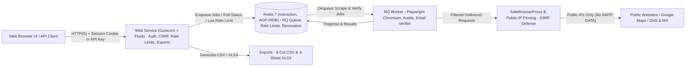
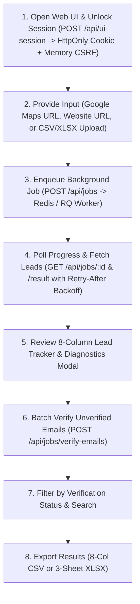
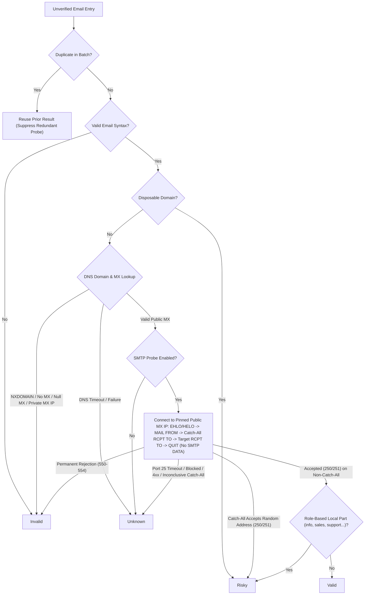

# LeadHunter Studio

**Lead Intelligence, Website Auditing & Batch Email Verification Platform** built with **Python 3.12+**, **Flask**, **Playwright Chromium**, **Redis 7**, and **RQ**.

LeadHunter Studio turns Google Maps search results, individual business URLs, or uploaded CSV/Excel lead lists into structured, outreach-ready datasets. It performs automated multi-page website discovery and technical/SEO/feature audits behind SSRF and DNS-rebinding defenses, runs non-intrusive batch email verification via background workers, and exports clean **8-column Lead Tracker CSVs** alongside **3-sheet Lead Intelligence Excel workbooks (`8 / 15 / 7` columns)** without discarding underlying diagnostic data.

Repository: `https://github.com/mamunaio/google-map-scrapper`

---

## Table of Contents

- [Core Features](#core-features)
- [Architecture & Technology Stack](#architecture--technology-stack)
- [Application Workflow](#application-workflow)
- [Docker Local Setup (Recommended)](#docker-local-setup-recommended)
- [Native Local Development Setup](#native-local-development-setup)
- [Render Production Deployment](#render-production-deployment)
- [Environment Variables](#environment-variables)
- [Authentication & Security Architecture](#authentication--security-architecture)
- [Email Verification Workflow & SMTP Limitations](#email-verification-workflow--smtp-limitations)
- [Standardized Export Schemas](#standardized-export-schemas)
- [API Reference](#api-reference)
- [Testing & Verification](#testing--verification)
- [Troubleshooting](#troubleshooting)
- [Responsible Scraping & Data Usage](#responsible-scraping--data-usage)
- [Repository Structure](#repository-structure)
- [Roadmap](#roadmap)

---

## Core Features

- **Google Maps & Bulk Website Lead Extraction**
  - Extracts business listings from Google Maps search URLs (`max_results` 1–50 per job) with dynamic feed pagination.
  - Supports single-website enrichment and bulk CSV/XLSX file uploads with **Smart Skip** to avoid re-crawling rows that already contain contact emails.
- **Automated Website Intelligence & Opportunity Detection**
  - Crawls public business pages (`services/website_crawler.py`) to extract contact emails, decision makers, phone numbers, and social links.
  - Audits on-page SEO (`title`, meta description, canonicals, `robots.txt`/`sitemap.xml`, `H1` tags, image `alt` coverage), technical posture (HTTPS/SSL, viewport/mobile usability), optional Google PageSpeed Insights metrics, and business feature signals (lead capture forms, booking widgets, chatbots, voice agents, CRM/review tooling).
  - Computes transparent lead scores, priorities (`High`, `Medium`, `Low`, `Manual Review`), and evidence-backed business opportunities viewable per lead in the interactive Diagnostics Modal.
- **Asynchronous Background Processing (Redis 7 + RQ)**
  - Offloads long-running Playwright scraping, website auditing, and batch email verification to dedicated RQ worker processes with atomic job deduplication reservations, retries, bounded timeouts, and live progress polling.
- **Batch Email Verification Engine**
  - Verifies all `Unverified` lead records in the UI via **Verify Emails** (`POST /api/jobs/verify-emails`) with batch duplicate suppression, live processed/remaining counters, real-time `Valid` / `Risky` / `Invalid` / `Unknown` counts, and status filtering.
  - Built on a provider-independent registry (`FreeEmailVerificationProvider` by default) designed to plug in third-party verification APIs without changing routes or UI code.
- **Standardized Exports Without Data Loss**
  - Streamlined **8-column Lead Tracker** in the UI table, CSV export, and Excel Sheet 01 (`Business Name`, `Contact Person`, `Email`, `Email Status`, `Phone`, `Website`, `City`, `State`).
  - Full **3-Sheet Intelligence Workbook (`.xlsx`)** pairing the 8-column **Lead Tracker** with the 15-column **Website Audit** and 7-column **Business Opportunities** sheets, preserving all underlying lead fields (`Category`, `Google Maps URL`, `Rating`, `Reviews`, `Priority`, `Lead Score`, `Main Opportunity`, `Notes`, `intelligence`, and `email_verification_details`).
- **Defense-in-Depth Security Controls**
  - Fail-closed dual-mode authentication (API key / Bearer token + explicit UI session cookie with in-memory CSRF token and Redis-backed logout revocation).
  - Split read/write atomic Redis Lua sliding-window rate limiting with fail-closed production enforcement.
  - Outbound SSRF and DNS-rebinding protections (`SafeBrowserProxy`, Playwright route interception, and pinned public-IP TLS/SMTP connections) plus DOM XSS mitigation (zero `.innerHTML` rendering in the UI).

---

## Architecture & Technology Stack



### Technology Stack

| Layer | Technology | Role in Repository |
| :--- | :--- | :--- |
| **Runtime** | Python 3.12+ (`python:3.12-slim-bookworm`) | Application & worker baseline (`Dockerfile`) |
| **Web & API** | Flask 3.1.3, Werkzeug 3.1.9, Gunicorn 27.0.1 (`gthread`), WhiteNoise 6.12.0 | API gateway, UI rendering, static asset serving (`app.py`, `gunicorn.conf.py`) |
| **Queue & State** | Redis 7 (`noeviction`), `redis-py` 8.1.0, RQ 3.0.0 | Async job execution, atomic Lua rate limiting, cross-worker session revocation (`worker.py`, `services/job_queue.py`, `services/rate_limiter.py`) |
| **Browser & Parsing** | Playwright 1.65.1 (Chromium), BeautifulSoup4 4.15.0, `requests` 2.34.2 | Google Maps extraction & website intelligence crawling (`services/maps_scraper.py`, `services/website_crawler.py`) |
| **Email Verification** | `email-validator` 2.3.0, `dnspython` 2.9.2, Python `smtplib` (RCPT-only) | Syntax, DNS/MX, disposable/role checks & optional SMTP probing (`services/email_verifier.py`) |
| **Reporting & Export** | `pandas` 3.1.1, `openpyxl` 3.1.5 | 8-column CSV & styled 3-sheet Excel generation (`services/export_service.py`) |
| **Frontend UI** | Jinja2 template, local Tailwind CSS bundle (`static/`), PapaParse | Single-page operational dashboard (`templates/index.html`) |
| **Testing** | `pytest` 9.2.0, `fakeredis` 2.40.0, Playwright Chromium | Unit, security, runtime, export-schema & Chromium UI tests (`tests/`) |

---

## Application Workflow



---

## Docker Local Setup (Recommended)

The repository includes an isolated local staging stack in `docker-compose.local.yml` that runs **Redis 7** (AOF + RDB persistence, `noeviction`, named volume `leadhunter_local_redis_data`), **Gunicorn Web** (bound strictly to `127.0.0.1:5000`), and the **RQ Playwright Worker** (`init: true`, `shm_size: 256m`) on a dedicated internal network (`leadhunter_local_net`).

### 1. Clone the repository

```bash
git clone https://github.com/mamunaio/google-map-scrapper.git
cd google-map-scrapper
```

### 2. Create `.env.local` (gitignored)

Copy `.env.example` to `.env.local` and replace `LEADHUNTER_API_KEY` with a strong random secret:

```bash
# Linux / macOS
cp .env.example .env.local

# Windows PowerShell
Copy-Item .env.example .env.local
```

Recommended `.env.local` values for local Docker staging:

```dotenv
LEADHUNTER_API_KEY=replace_with_a_strong_random_key_at_least_32_chars
LEADHUNTER_ENV=development
REQUIRE_ACTIVE_WORKER=true
RATE_LIMIT_MAX_REQUESTS=30
RATE_LIMIT_READ_MAX_REQUESTS=120
RATE_LIMIT_WINDOW_SECONDS=60
RATE_LIMIT_FAIL_CLOSED=true
TRUSTED_PROXY_HOPS=0
BROWSER_MAX_CONCURRENCY=1
LOG_FORMAT=json
# Optional:
GOOGLE_PAGESPEED_API_KEY=
```

> `docker-compose.local.yml` injects `SERVICE_ROLE` and `REDIS_URL=redis://redis:6379/0` automatically for `web` and `worker`. Redis is internal-only on `leadhunter_local_net` and does not conflict with host port `6379`.

### 3. Build and start the stack

```bash
docker compose -f docker-compose.local.yml up -d --build
```

### 4. Verify container health and readiness

```bash
docker compose -f docker-compose.local.yml ps
curl -s http://127.0.0.1:5000/healthz
curl -s http://127.0.0.1:5000/readyz
```

Expected `/readyz` response when all services are healthy:

```json
{
  "checks": {
    "api_key_configured": true,
    "chromium": {"detail": "Chromium installation detected", "ok": true},
    "redis": {"detail": "Redis reachable", "ok": true},
    "workers": {"detail": "1 active RQ worker(s) registered", "ok": true, "online": 1, "required": true}
  },
  "status": "ready"
}
```

Open `http://127.0.0.1:5000` in your browser, paste your `LEADHUNTER_API_KEY` into the session unlock bar, and click **Unlock**.

### 5. Rebuilding application code without touching Redis data

```bash
docker compose -f docker-compose.local.yml build web worker
docker compose -f docker-compose.local.yml up -d --no-deps --force-recreate web worker
```

---

## Native Local Development Setup

For direct host development outside Docker:

```bash
python -m venv .venv
# Windows PowerShell: .\.venv\Scripts\Activate.ps1
# Linux / macOS:      source .venv/bin/activate

pip install -r requirements.txt
pip install -r requirements-dev.txt
python -m playwright install chromium

cp .env.example .env
# Edit .env and set LEADHUNTER_API_KEY and REDIS_URL=redis://127.0.0.1:6379/0
```

Start Redis 7 with `noeviction`:

```bash
docker run -d --name leadhunter-redis7 -p 127.0.0.1:6379:6379 \
  redis:7-alpine redis-server --maxmemory 128mb --maxmemory-policy noeviction
```

Run the web app and RQ worker in separate terminals:

```bash
# Terminal 1 — Web UI & API (binds to 127.0.0.1:5000)
python app.py

# Terminal 2 — Dedicated RQ Background Worker
python worker.py
```

`app.py` and `worker.py` automatically load `<project_root>/.env` in local development without overriding existing shell environment variables (loading is skipped automatically in production and under `pytest`).

---

## Render Production Deployment

The repository includes a shared production `Dockerfile` (non-root `appuser`, Playwright Chromium + `libatomic1`, role-aware `HEALTHCHECK`) and a Render Blueprint (`render.yaml`):

- **Web service (`SERVICE_ROLE=web`):** Runs `gunicorn -c gunicorn.conf.py app:app`, `LEADHUNTER_ENV=production`, `UI_AUTO_SESSION=false`, `REQUIRE_ACTIVE_WORKER=true`, `RATE_LIMIT_FAIL_CLOSED=true`, `TRUSTED_PROXY_HOPS=1`.
- **Worker service (`SERVICE_ROLE=worker`):** Uses the same image with `python worker.py` and `BROWSER_MAX_CONCURRENCY=1`.
- **Redis service:** Managed Redis 7 configured with `maxmemoryPolicy: noeviction`.
- **Secrets (`sync: false`):** Configure `LEADHUNTER_API_KEY` (required) and `GOOGLE_PAGESPEED_API_KEY` (optional) in the Render dashboard.

---

## Environment Variables

Never commit `.env`, `.env.local`, or real secrets. All values below are safe placeholders or defaults read from the codebase.

### Core & Authentication

| Variable | Default | Description |
| :--- | :--- | :--- |
| `LEADHUNTER_API_KEY` | *(required)* | Master API key. All protected endpoints fail closed with HTTP `503` if unset. |
| `LEADHUNTER_ENV` | `development` | Set to `production` for production deployments (unconditionally disables Flask debug). |
| `SERVICE_ROLE` | `web` | Container role (`web` or `worker`) used by Docker `HEALTHCHECK`. |
| `PORT` | `5000` | HTTP port bound by Flask/Gunicorn. |
| `FLASK_DEBUG` | `false` | Local debug toggle (ignored in production). |
| `MAX_CONTENT_LENGTH` | `5242880` | Max request body size in bytes (5 MB default; bounded 1 KB–50 MB). |

### UI Sessions & Reverse Proxy

| Variable | Default | Description |
| :--- | :--- | :--- |
| `UI_SESSION_TTL_SECONDS` | `28800` | Explicit and auto UI session cookie TTL in seconds (8 hours; bounded 60–86400). |
| `UI_AUTO_SESSION` | Auto (`true` on strict local loopback only) | Explicitly enables/disables loopback auto-session cookie on `GET /`. Disabled by default in containers and production. |
| `TRUSTED_PROXY_HOPS` | `0` | Number of trusted upstream reverse proxies (`ProxyFix`). Use `0` locally, `1` behind Render/Nginx. |
| `UI_AUTO_SESSION_BEHIND_TRUSTED_AUTH_PROXY` | `false` | Advanced opt-in for auto-sessions behind an upstream authenticating proxy. |
| `TRUSTED_AUTH_PROXY_SECRET` | *(unset)* | Separate shared secret (must differ from `LEADHUNTER_API_KEY`) required when `UI_AUTO_SESSION_BEHIND_TRUSTED_AUTH_PROXY=true`. |
| `TRUSTED_AUTH_PROXY_HEADER` | `X-Trusted-Auth-Proxy-Secret` | Header injected by the authenticating reverse proxy. |

### Redis & RQ Background Worker

| Variable | Default | Description |
| :--- | :--- | :--- |
| `REDIS_URL` | *(empty)* | Redis connection URI (e.g., `redis://127.0.0.1:6379/0` or `redis://redis:6379/0`). Required for async jobs, shared rate limiting, and cross-worker session revocation. |
| `RQ_QUEUE_NAME` | `leadhunter` | RQ queue name consumed by `worker.py`. |
| `REQUIRE_ACTIVE_WORKER` | `false` (`true` in prod) | When `true`, `/readyz` and job enqueueing require at least one fresh RQ worker heartbeat. |
| `JOB_TIMEOUT_SECONDS` | `900` | Max runtime per background job (30–3600s). |
| `JOB_RESULT_TTL_SECONDS` | `3600` | Retention TTL for completed job results in Redis. |
| `JOB_FAILURE_TTL_SECONDS` | `3600` | Retention TTL for failed job metadata in Redis. |
| `JOB_DEDUP_TTL_SECONDS` | `900` | Deduplication key TTL matching job timeout by default. |
| `JOB_MAX_RETRIES` | `2` | Bounded retry count for transient job failures (0–5). |
| `WORKER_HEARTBEAT_MAX_AGE_SECONDS` | `120` | Maximum worker heartbeat age considered healthy by `/readyz` and `worker.py --healthcheck`. |
| `WORKER_TTL_SECONDS` | `120` | RQ worker registration TTL in Redis. |

### Rate Limiting

| Variable | Default | Description |
| :--- | :--- | :--- |
| `RATE_LIMIT_MAX_REQUESTS` | `30` | Max write/compute requests per client per window (`/api/jobs`, `/api/jobs/verify-emails`, `/api/scrape`, `/api/audit`, `/api/export-*`, `/api/ui-session`). |
| `RATE_LIMIT_WINDOW_SECONDS` | `60` | Sliding window duration in seconds for the write/compute bucket. |
| `RATE_LIMIT_READ_MAX_REQUESTS` | `120` | Separate read-only polling bucket limit for `GET /api/jobs/<id>` and `GET /api/jobs/<id>/result`. |
| `RATE_LIMIT_READ_WINDOW_SECONDS` | `RATE_LIMIT_WINDOW_SECONDS` | Sliding window duration in seconds for the read polling bucket. |
| `RATE_LIMIT_FAIL_CLOSED` | `true` in prod / `false` in dev | When `true`, returns HTTP `503` instead of downgrading to process-local memory if Redis fails. |

### Email Verification Engine

| Variable | Default | Description |
| :--- | :--- | :--- |
| `EMAIL_VERIFIER_PROVIDER` | `free_dns_smtp` | Active verification provider key registered in `services/email_verifier.py`. |
| `EMAIL_VERIFY_ENABLE_SMTP_PROBE` | `true` | Enables polite SMTP `RCPT TO` & catch-all probing (`false` runs syntax/DNS/MX/disposable checks only; MX-only never returns `Valid`). |
| `EMAIL_VERIFY_DNS_TIMEOUT_SECONDS` | `5` | DNS query timeout (1–30s). |
| `EMAIL_VERIFY_SMTP_TIMEOUT_SECONDS` | `5` | Outbound SMTP socket timeout (1–30s). |
| `EMAIL_VERIFY_MAX_RETRIES` | `1` | Retries on temporary SMTP `4xx` / timeout responses (0–3). |
| `EMAIL_VERIFY_DOMAIN_DELAY_MS` | `250` | Polite per-domain delay in milliseconds between probes (0–5000 ms). |

### Browser, Gunicorn, Logging & External Integrations

| Variable | Default | Description |
| :--- | :--- | :--- |
| `BROWSER_MAX_CONCURRENCY` | `2` (`1` in Docker/Render) | Max concurrent Playwright Chromium instances per worker process. |
| `BROWSER_ACQUIRE_TIMEOUT_SECONDS` | `30` | Timeout waiting for a Chromium concurrency slot. |
| `CHROMIUM_NO_SANDBOX` | `false` (`true` in containers) | Passes `--no-sandbox` when running Chromium inside containers. |
| `WEB_CONCURRENCY` | `2` | Gunicorn worker process count (`gunicorn.conf.py`). |
| `GUNICORN_THREADS` | `4` | Gunicorn threads per worker (`gthread`). |
| `GUNICORN_TIMEOUT` | `60` | Gunicorn worker timeout in seconds. |
| `GUNICORN_GRACEFUL_TIMEOUT` | `30` | Gunicorn graceful shutdown window. |
| `LOG_LEVEL` | `INFO` | Python logging level (`DEBUG`, `INFO`, `WARNING`, `ERROR`). |
| `LOG_FORMAT` | `text` (`json` in prod) | Structured JSON or plain text logs. |
| `GOOGLE_PAGESPEED_API_KEY` | *(optional)* | Optional Google PageSpeed Insights API key for mobile/desktop performance scores & Core Web Vitals. |

---

## Authentication & Security Architecture

LeadHunter Studio enforces **fail-closed authentication** across all protected `/api/*` endpoints:

1. **Programmatic API Clients (All Environments)**
   - Authenticate via `X-API-Key: <LEADHUNTER_API_KEY>` or `Authorization: Bearer <LEADHUNTER_API_KEY>`.
   - Unset server `LEADHUNTER_API_KEY` → HTTP `503`. Missing or invalid credentials → HTTP `401`.
2. **Explicit Browser UI Sessions (`POST /api/ui-session` & `DELETE /api/ui-session`)**
   - Used in Docker staging, production, and any non-loopback deployment.
   - Submitting the Access Key exchanges it once at `POST /api/ui-session` for a domain-separated HMAC-SHA256 signed `HttpOnly; SameSite=Strict` cookie (`lh_ui_session`, marked `Secure` on HTTPS) and a paired `X-CSRF-Token` stored **only in JavaScript memory** (never in `sessionStorage`, `localStorage`, or readable cookies).
   - Every session-authenticated request validates the HMAC signature, expiry (`UI_SESSION_TTL_SECONDS`), revocation state in Redis, constant-time `X-CSRF-Token`, and strict same-origin headers (`Origin`, `Referer`, `Sec-Fetch-Site: same-origin`).
   - Clicking **Lock** calls `DELETE /api/ui-session`, revoking the session nonce in Redis across all Gunicorn workers and clearing the cookie. When Redis is configured (`REDIS_URL` set) but unavailable, revocation checks and logout fail closed (`HTTP 401` on verification, `HTTP 503` on logout).
3. **Loopback Local Auto-Session & Trusted Auth Proxy Opt-In**
   - Strictly local non-container loopback development (`127.0.0.1`/`localhost`/`::1`, `TRUSTED_PROXY_HOPS=0`) may auto-issue a separate domain-separated `auto` UI session on `GET /`.
   - Behind an authenticating reverse proxy, auto-sessions remain disabled unless `UI_AUTO_SESSION=true`, `UI_AUTO_SESSION_BEHIND_TRUSTED_AUTH_PROXY=true`, `TRUSTED_PROXY_HOPS > 0`, and a distinct `TRUSTED_AUTH_PROXY_SECRET` header are all configured alongside network-level origin isolation.
4. **Split Atomic Rate Limiting**
   - Redis Lua sliding-window counters enforce separate buckets: **write/compute (`30/60s`)** vs. **read-only job polling (`120/60s`)** so multi-URL batch monitoring is not interrupted by polling traffic while abuse protection stays strict.
   - The frontend honors `Retry-After` headers with bounded exponential polling backoff.
5. **SSRF, DNS-Rebinding & XSS Hardening**
   - Target URLs are validated before enqueueing and during crawling (`services/security.py`).
   - Outbound Chromium traffic routes through `SafeBrowserProxy` and Playwright request interception to block private, loopback, link-local, metadata (`169.254.169.254`), and `data:` navigations.
   - TLS checks and SMTP verification pin validated public IP addresses directly.
   - The frontend avoids `.innerHTML` and sanitizes external links before rendering.

---

## Email Verification Workflow & SMTP Limitations

Clicking **Verify Emails** collects all lead rows currently marked `Email Status = Unverified` (including non-empty malformed strings so syntax validation catches them), excludes already-verified or empty (`Not Found`) records, submits them to `POST /api/jobs/verify-emails`, and updates progress, remaining counts, and all four outcome counters in real time.



### Verification Classification Rules

| Status | Meaning |
| :--- | :--- |
| **`Valid`** | Syntax, DNS, public MX, non-disposable, non-role, confirmed non-catch-all probe, and explicit SMTP `250`/`251` recipient acceptance all pass. |
| **`Risky`** | Disposable/temporary email domain, catch-all mail server, or role-based mailbox (`info@`, `sales@`, `support@`, etc.). |
| **`Invalid`** | Malformed syntax, non-existent domain (`NXDOMAIN`), domain without MX or advertising RFC 7505 null MX (`0 .`), private/SSRF-blocked MX IP, or permanent SMTP rejection (`550`–`554`) on a non-catch-all server. |
| **`Unknown`** | DNS timeout/failure, outbound TCP port 25 blocked or timed out, greylisting / temporary `4xx` response, inconclusive catch-all probe, or SMTP probing disabled (`MX Only`). |

### Important SMTP & Honesty Guarantees

- **Zero Emails Are Ever Sent:** `FreeEmailVerificationProvider` issues `EHLO` (with `HELO` fallback), `MAIL FROM`, catch-all `RCPT TO`, and target `RCPT TO`, then closes the session with `QUIT` (falling back to socket `close()` on error). `smtplib.SMTP.data`, `sendmail`, and `send_message` are never called.
- **No False `Valid` Claims:** MX validation alone proves only that a domain advertises mail servers — **never** that a specific mailbox exists. Any MX-only, timed-out, blocked, or inconclusive result is strictly classified as `Unknown`, never `Valid`.
- **Outbound Port 25 Limitations:** Many residential ISPs, corporate networks, and cloud providers (including Render, AWS, GCP, and Azure by default) restrict outbound TCP port `25`. In those environments, syntax, NXDOMAIN, null MX, and disposable-domain checks still classify `Invalid` and `Risky` accurately, while live MX domains whose SMTP probes time out are honestly reported as `Unknown`.
- **Pluggable Provider Architecture:** To perform deep mailbox verification in port-25-restricted environments, register a third-party provider (e.g., ZeroBounce or NeverBounce adapter) via `register_email_verification_provider()` in `services/email_verifier.py` and select it with `EMAIL_VERIFIER_PROVIDER` or the request `"provider"` field.

---

## Standardized Export Schemas

LeadHunter Studio enforces consistent schemas across the UI table, CSV downloads, and Excel workbooks while **preserving all underlying lead data** (such as `Category`, `Google Maps URL`, `Rating`, `Reviews`, `Priority`, `Lead Score`, `Main Opportunity`, `Notes`, `intelligence`, and `email_verification_details`) in memory, JSON job results, the Diagnostics Modal, and Sheets 02/03.

### 1. Lead Tracker — 8 Columns (UI Table, CSV Export & XLSX Sheet 01)

| # | Column Name |
| :-: | :--- |
| 1 | `Business Name` |
| 2 | `Contact Person` |
| 3 | `Email` |
| 4 | `Email Status` |
| 5 | `Phone` |
| 6 | `Website` |
| 7 | `City` |
| 8 | `State` |

### 2. Website Audit — 15 Columns (XLSX Sheet 02)

| # | Column Name |
| :-: | :--- |
| 1 | `Business Name` |
| 2 | `Website` |
| 3 | `Website Status` |
| 4 | `Page Title` |
| 5 | `Meta Description Status` |
| 6 | `Canonical Status` |
| 7 | `Indexability / Robots Status` |
| 8 | `H1 Status` |
| 9 | `Image Alt Status` |
| 10 | `Mobile / Viewport Status` |
| 11 | `HTTPS Status` |
| 12 | `Performance Status` |
| 13 | `Key SEO Issues` |
| 14 | `Technical Issues` |
| 15 | `Audit Summary` |

### 3. Business Opportunities — 7 Columns (XLSX Sheet 03)

| # | Column Name |
| :-: | :--- |
| 1 | `Business Name` |
| 2 | `Opportunity Category` |
| 3 | `Finding` |
| 4 | `Evidence` |
| 5 | `Confidence` |
| 6 | `Research Status` |
| 7 | `Recommended Service` |

*(Excel export also supports `format_type: "source_enriched"` on `/api/export-excel` to append audit columns onto an uploaded dataset.)*

---

## API Reference

All `/api/*` endpoints (except `/api/ui-session` unlock/lock, which authenticate directly) accept either `X-API-Key` / `Authorization: Bearer` or a valid `lh_ui_session` cookie paired with `X-CSRF-Token`.

| Method | Endpoint | Auth | Rate-Limit Bucket | Purpose |
| :--- | :--- | :--- | :--- | :--- |
| `GET` | `/` | Public (UI) | None | Renders LeadHunter Studio web UI. |
| `GET` | `/healthz` | Public | None | Lightweight liveness probe (`200 OK`). |
| `GET` | `/readyz` | Public | None | Readiness probe: API key, Redis, active RQ workers, Playwright Chromium (`200` / `503`). |
| `POST` | `/api/ui-session` | `X-API-Key` or `Bearer` + Same-Origin | Write (`30/60s`) | Exchanges API key for `HttpOnly` explicit UI session cookie + in-memory `csrf_token`. |
| `DELETE` | `/api/ui-session` | Valid explicit UI session + CSRF + Same-Origin | Write (`30/60s`) | Revokes explicit UI session nonce in Redis and clears cookie (`200` / `503`). |
| `POST` | `/api/jobs` | API Key or UI Session | Write (`30/60s`) | Enqueues async Maps (`type: "maps"`) or website (`type: "website"`) job (`202 Accepted`). |
| `POST` | `/api/jobs/verify-emails` | API Key or UI Session | Write (`30/60s`) | Enqueues async batch email verification job (max 500 items per batch; `202 Accepted`). |
| `GET` | `/api/jobs/<job_id>` | API Key or UI Session | Read (`120/60s`) | Returns normalized job status (`queued`, `started`, `finished`, `failed`) and live progress. |
| `GET` | `/api/jobs/<job_id>/result` | API Key or UI Session | Read (`120/60s`) | Returns completed job payload (scraped leads or verification results & status counts). |
| `POST` | `/api/scrape` | API Key or UI Session | Write (`30/60s`) | Synchronous scrape/audit endpoint (`type: "maps"` or `"website"`). |
| `POST` | `/api/audit` | API Key or UI Session | Write (`30/60s`) | Direct website intelligence audit for a single `url`. |
| `POST` | `/api/export-csv` | API Key or UI Session | Write (`30/60s`) | Generates standardized 8-column Lead Tracker `.csv` (max 1,000 leads). |
| `POST` | `/api/export-excel` | API Key or UI Session | Write (`30/60s`) | Generates styled 3-sheet `.xlsx` (`standard_3_sheet`, default) or `source_enriched` (max 1,000 leads). |

### Example Requests

```bash
# 1. Enqueue a website intelligence job
curl -X POST http://127.0.0.1:5000/api/jobs \
  -H "Content-Type: application/json" \
  -H "Authorization: Bearer <YOUR_API_KEY>" \
  -d '{"url": "https://example.com", "type": "website", "business_name": "Example Co"}'

# 2. Enqueue a batch email verification job
curl -X POST http://127.0.0.1:5000/api/jobs/verify-emails \
  -H "Content-Type: application/json" \
  -H "Authorization: Bearer <YOUR_API_KEY>" \
  -d '{"items": [{"row_index": 0, "email": "contact@example.com"}]}'

# 3. Poll job status & retrieve results
curl -H "Authorization: Bearer <YOUR_API_KEY>" http://127.0.0.1:5000/api/jobs/<JOB_ID>
curl -H "Authorization: Bearer <YOUR_API_KEY>" http://127.0.0.1:5000/api/jobs/<JOB_ID>/result

# 4. Export standardized 8-column Lead Tracker CSV
curl -X POST http://127.0.0.1:5000/api/export-csv \
  -H "Content-Type: application/json" \
  -H "Authorization: Bearer <YOUR_API_KEY>" \
  -d '{"leads": [{"Business Name": "Example Co", "Email": "contact@example.com", "Email Status": "Unknown"}]}' \
  -o LeadHunter_Lead_Tracker.csv
```

---

## Testing & Verification

Install development dependencies (`pytest`, `fakeredis`):

```bash
pip install -r requirements-dev.txt
```

Run the automated test suite:

```bash
# Full test suite (unit, security, runtime, export schemas, email verifier, Chromium UI)
pytest -q

# Verbose output
pytest -v

# Targeted suites
pytest tests/test_security_phase10_1a.py tests/test_runtime_phase10_1b.py
pytest tests/test_email_verifier.py tests/test_export_service.py tests/test_data_quality_remediation.py
```

Infrastructure & integration verification scripts:

```bash
# Verify atomic Redis 7 Lua sliding-window rate limiter against live Redis
REDIS_URL=redis://127.0.0.1:6379/0 python scripts/verify_live_redis_lua.py

# Verify worker healthcheck CLI
python worker.py --healthcheck

# Verify Linux Docker build and web/worker/Redis integration smoke test
bash scripts/verify_docker_smoke.sh
```

---

## Troubleshooting

| Symptom | Likely Cause | Resolution |
| :--- | :--- | :--- |
| **HTTP `503` on `/api/*` or `/readyz`** | `LEADHUNTER_API_KEY` is unset, Redis is unreachable, or no active RQ worker heartbeat is registered when `REQUIRE_ACTIVE_WORKER=true`. | Check `/readyz` JSON `checks` details; ensure `.env`/`.env.local` defines `LEADHUNTER_API_KEY` and both `redis` and `worker` are healthy. |
| **HTTP `401 Unauthorized` in Web UI** | UI session is locked, expired (`UI_SESSION_TTL_SECONDS`), or revoked after clicking **Lock**. | Re-unlock the session via the top authentication bar with your `LEADHUNTER_API_KEY`. |
| **HTTP `429 Too Many Requests`** | Client exceeded `RATE_LIMIT_MAX_REQUESTS` (`30/60s` write) or `RATE_LIMIT_READ_MAX_REQUESTS` (`120/60s` read). | Honor the `Retry-After` response header or tune rate-limit environment variables for trusted internal deployments. |
| **Valid-looking emails return `Unknown`** | Outbound TCP port `25` is blocked or timed out on your network/cloud host, or the remote MX server returned greylisting (`4xx`) / inconclusive catch-all results. | Expected honest behavior (MX-only is never marked `Valid`). Use a network allowing outbound port 25 or register an external API provider via `services/email_verifier.py`. |
| **Playwright Chromium crashes in Docker** | Insufficient `/dev/shm` memory or missing zombie-process reaping. | Keep `shm_size: 256m`, `init: true`, and `BROWSER_MAX_CONCURRENCY=1` on the worker container (already configured in `docker-compose.local.yml`). |
| **Redis job data evicted unexpectedly** | Redis `maxmemory-policy` is not set to `noeviction`. | Always run Redis 7 with `--maxmemory-policy noeviction` (configured in `docker-compose.local.yml` and `render.yaml`). |

---

## Responsible Scraping & Data Usage

- **Respect Platform Policies & Laws:** Use LeadHunter Studio only in compliance with applicable laws, regulations, and the Terms of Service of target websites and directories.
- **Keep Concurrency Conservative:** Retain bounded worker concurrency (`BROWSER_MAX_CONCURRENCY=1`) and polite per-domain delays (`EMAIL_VERIFY_DOMAIN_DELAY_MS`) to avoid degrading third-party servers.
- **Privacy & Outreach Compliance:** Collected B2B contact records may still contain personal data under GDPR, CCPA/CPRA, PECR, CAN-SPAM, or local regulations. Maintain lawful basis, honor opt-out requests, and store exported spreadsheets securely.
- **Non-Intrusive Verification:** Do not modify the email verifier to send unsolicited messages or bypass rate limits.

---

## Repository Structure

```text
app.py                    # Flask API gateway, dual-mode auth, rate limiting, health/readiness probes
worker.py                 # Dedicated RQ background worker & --healthcheck CLI
gunicorn.conf.py          # Production Gunicorn WSGI configuration
Dockerfile                # Shared production Docker image (web + worker + Playwright Chromium)
docker-compose.local.yml  # Isolated local Docker staging stack (Redis 7 + web + worker)
render.yaml               # Render Docker Blueprint (web + worker + managed Redis 7)
requirements.txt          # Pinned production dependencies
requirements-dev.txt      # Development & test dependencies (pytest, fakeredis)
.env.example              # Safe environment variable template
services/                 # Modular scraping, auditing, security, scoring, email verification, queue & export
templates/                # Web UI template (zero innerHTML, explicit session/CSRF aware)
static/                   # Local static assets (Tailwind CSS bundle)
tests/                    # Automated unit, security, runtime, email verification & export parity tests
scripts/                  # Live Redis 7 Lua EVAL & Docker integration verification scripts
docs/reports/             # Phase audits, hardening & verification reports
docs/pilots/              # Archived Dallas HVAC pilot verification exports (CSV/JSON/XLSX)
```

---

## Roadmap

### Completed (Implemented & Verified)

- [x] Google Maps multi-lead extraction with dynamic feed pagination and CSV/XLSX bulk enrichment
- [x] Modular website intelligence auditing (SEO, SSL/technical, mobile usability, business features, optional PageSpeed Insights)
- [x] Evidence-backed lead scoring, priority normalization, and Business Opportunities analysis
- [x] Redis 7 + RQ asynchronous worker architecture with atomic deduplication, retries, and `/healthz` + `/readyz` probes
- [x] Dual-mode fail-closed authentication, explicit UI sessions (`POST`/`DELETE /api/ui-session`), in-memory CSRF, and Redis-backed cross-worker revocation
- [x] Split read/write atomic Redis Lua sliding-window rate limiting with fail-closed enforcement and frontend `Retry-After` backoff
- [x] SSRF & DNS-rebinding defenses (`SafeBrowserProxy`, Playwright route filtering, pinned public-IP TLS/SMTP sockets) and DOM XSS remediation
- [x] Batch email verification engine (syntax, DNS/MX, null MX, disposable/role/catch-all detection, port-25 timeout honesty, duplicate suppression, status filters, pluggable provider registry)
- [x] Simplified 8-column Lead Tracker schema across UI, CSV, and XLSX Sheet 01 alongside 15-column Website Audit and 7-column Business Opportunities sheets with zero underlying data loss
- [x] Local Docker staging stack (`docker-compose.local.yml`) and Render Blueprint (`render.yaml`)

### Planned (Not Yet Implemented)

- [ ] Built-in commercial email verification adapters (e.g., ZeroBounce / NeverBounce) using the existing provider registry
- [ ] Persistent database storage for multi-run lead workspaces and historical audit diffs
- [ ] Scheduled recurring audits and webhook / CRM export integrations
- [ ] Multi-user role-based access control (RBAC) for team deployments
